# Wira Bandar PC

**Build a Malaysian city and the public transport it runs on: bus contracts, BRT, rush hours, town
councils, state elections and a federal government.**

Wira Bandar PC is a fork of [OpenTTD](https://www.openttd.org), the free transport game: OpenTTD's code with
changes, not a game made from scratch. Everything OpenTTD has is still there, and a city-building and public
transport game set in Malaysia and Singapore comes on top. Like OpenTTD, it is free software under the GNU
General Public License version 2, and this repository is its source code.

  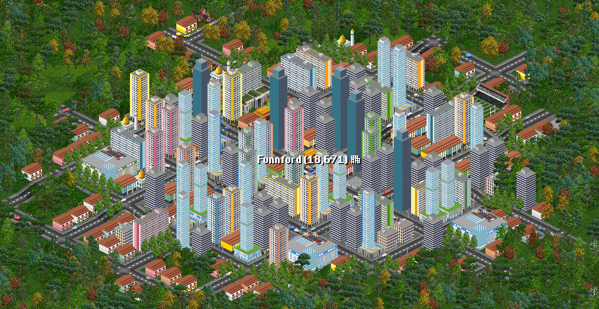

  <a href="https://github.com/hithereiamaliff/wirabandar/releases/latest"><b>Download for Windows</b></a> ·
  <a href="https://wirabandar.techmavie.digital"><b>Read the guides</b></a> ·
  <a href="https://wirabandar.techmavie.digital/pc/tutorials/first-bus-network/">Your first bus network</a> ·
  <a href="docs/wirabandar-changelog.md">What's new</a> ·
  <a href="https://techmavie.digital/wira-bandar">About the game</a>

Free · 64-bit Windows · plays your OpenTTD saves and add-ons

## The name and the goal

**The name.** Wira Bandar means "town hero": *wira* is Malay for hero, *bandar* for town. The hero is
whoever makes a town work for the people who live there, and in this game that's you.

**The goal.** Build a city that moves people, not just cars: where the buses come on time, the air stays
clean, and every kampung can grow into a city worth living in.

## From the bus stop to the planner's desk

Transit apps answer the rider's question: when is my bus coming? Behind that question sit harder ones. Who
pays for the route? Why does the bus crawl through town at five o'clock? Why does one city get a BRT and
another a new highway?

Wira Bandar PC lets you answer them yourself. It takes OpenTTD, a transport game with more than twenty
years of work by its community, and adds the cities and the politics of Malaysia and Singapore: town
councils and their budgets, commuters who drive or ride, contracts from the towns' transit authorities,
voters who judge the service they get, and a federal government with plans of its own.

## Watch it play

<table>
  <tr>
    <td width="50%" valign="top">
      <a href="https://wirabandar.techmavie.digital/clips/traffic-lights.mp4">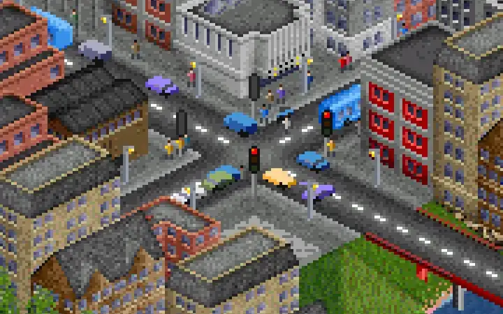</a> 
      <b>Traffic lights.</b> Smart lights: town traffic and buses take turns, with amber and all red in between. <a href="https://wirabandar.techmavie.digital/clips/traffic-lights.mp4">Full video</a>
    </td>
    <td width="50%" valign="top">
      <a href="https://wirabandar.techmavie.digital/clips/transit-b-busway.mp4">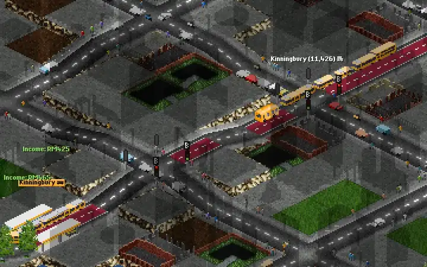</a> 
      <b>A BRT line at work.</b> Buses leave the BRT station and pass the queues on the busway, getting green first at the bus signals. <a href="https://wirabandar.techmavie.digital/clips/transit-b-busway.mp4">Full video</a>
    </td>
  </tr>
  <tr>
    <td width="50%" valign="top">
      <a href="https://wirabandar.techmavie.digital/clips/transit-b-rush-hour.mp4">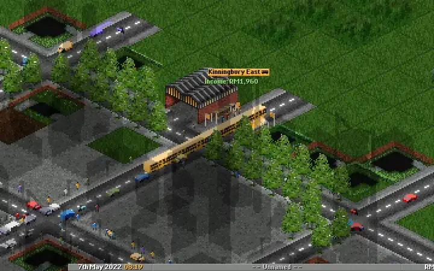</a> 
      <b>Rush hour.</b> Busy roads, crowds at the stops, and the city clock ticking in orange. <a href="https://wirabandar.techmavie.digital/clips/transit-b-rush-hour.mp4">Full video</a>
    </td>
    <td width="50%" valign="top">
      <a href="https://wirabandar.techmavie.digital/clips/transit-depot-yard.mp4">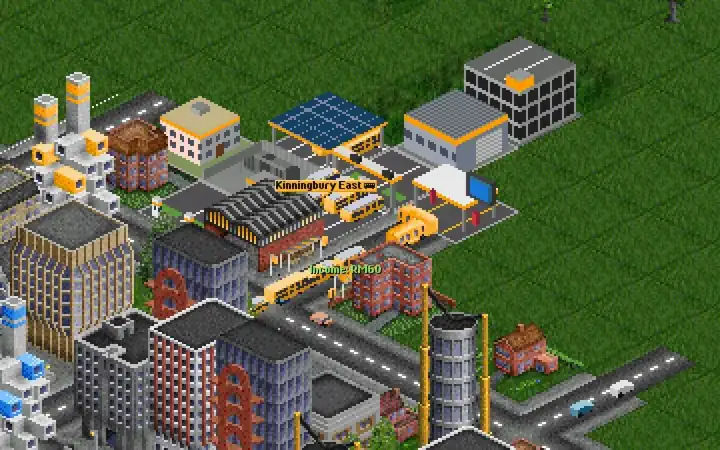</a> 
      <b>A depot yard.</b> Buses charge, park and get repaired at the end of their line. <a href="https://wirabandar.techmavie.digital/clips/transit-depot-yard.mp4">Full video</a>
    </td>
  </tr>
  <tr>
    <td width="50%" valign="top">
      <a href="https://wirabandar.techmavie.digital/clips/traffic-street-life.mp4">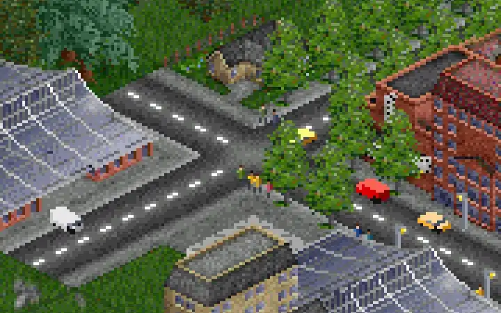</a> 
      <b>Street life.</b> Cars on the road, people on the pavements. <a href="https://wirabandar.techmavie.digital/clips/traffic-street-life.mp4">Full video</a>
    </td>
    <td width="50%" valign="top">
      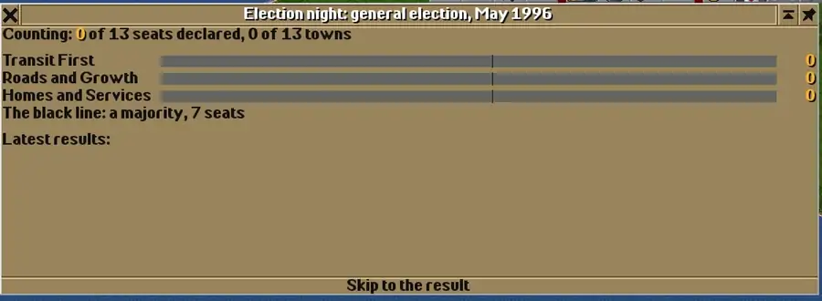 
      <b>Election night</b> (new in 0.4.0). The count, town by town, the big cities last, then the winner and the states' assemblies.
    </td>
  </tr>
</table>

## What's in it

- **[Traffic](https://wirabandar.techmavie.digital/pc/traffic/traffic-lights/).** Traffic lights with smart or
  fixed timings, vehicles that give way at junctions, town traffic that slows your buses, street life, and a
  traffic map that shows where it's held up.
- **[Towns](https://wirabandar.techmavie.digital/pc/towns/zoning/).** Zoning; police, fire, clinics, schools,
  hospitals, universities, stadiums and hawker centres; Malaysian and Singaporean buildings, shops and town
  names, from Kampar to Kuala Lumpur; budgets, ordinances, and commuting in and between towns.
- **[Government](https://wirabandar.techmavie.digital/pc/government/states-and-elections/).** Councils from
  Majlis Daerah to Majlis Bandaraya; states that elect their governments every five years, with the run-up to
  each election in the news and an election night that counts the seats; a federal government with national
  programmes, a five-year plan of projects for companies, and a transit agency in each federal territory;
  regions run like Sabah and Sarawak, with work passes and permits.
- **[Transit](https://wirabandar.techmavie.digital/pc/transit/lines/).** Lines and departure boards, fares and
  passes, contracts and tenders, modern and electric buses, depot yards and chargers, bus lanes, busways and BRT,
  expressways and tolls, interchanges and hubs, passenger satisfaction, rush hours and on-demand lines, metro
  and rail.
- **[Environment](https://wirabandar.techmavie.digital/pc/environment/pollution-and-land-value/).** Air
  pollution measured on Malaysia's API and Singapore's PSI, and land value that decides where towns build tall.
- **[Your way](https://wirabandar.techmavie.digital/pc/compared-with-openttd/).** Most new features have an Off
  setting that plays as in OpenTTD, and your OpenTTD saves, NewGRFs and AIs still work.

## Play the real playbook

Real Malaysian and Singaporean transit ideas, turned into play:

- **Bus contracts and free lines.** Towns invite tenders for your bus lines, like Singapore's Bus Contracting
  Model and BAS.MY: bid, run the line for five years and get paid by the departure. Some lines are free to
  ride, like Penang's CAT, and towns give their residents free passes, like Pas Mutiara, and pay you for them.
- **Priority for buses.** Paint bus lanes for all day or the peak hours, give buses their own signals at
  traffic lights, and build a kerbed busway or an elevated one with stations on the viaduct, Sunway style.
  Every line gets a BRT score.
- **Towns that grow up.** Kampung houses and shophouses give way to terrace houses, HDB-style blocks,
  condominiums and glass towers. Councils move up from Majlis Daerah to Majlis Perbandaran and Majlis
  Bandaraya, and run their estates like Singapore's town councils.
- **Voters who ride the bus.** States elect their governments every five years on the service voters get:
  traffic, transit, the air, city services, housing and taxes. Carry enough commuters and Transit First wins,
  and its grants fund more contracts.
- **Five-year plans.** The federal government offers companies projects in its five-year plan, as the
  Rancangan Malaysia does: a metro line for the capital, BRT lines, expressways, hospitals. Deliver one and it
  pays you, and voters remember it at the next general election. In the federal territories a transit agency,
  like Prasarana, tenders railway and BRT lines.

## Screenshots

<table>
  <tr>
    <td width="50%" valign="top">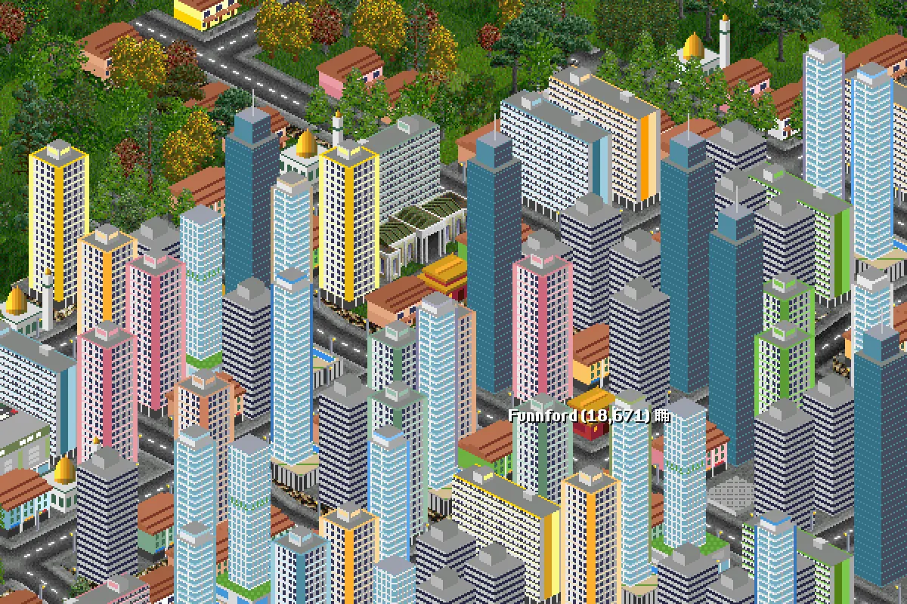 A Malaysian city in 2042: towns build taller where land is dear.</td>
    <td width="50%" valign="top">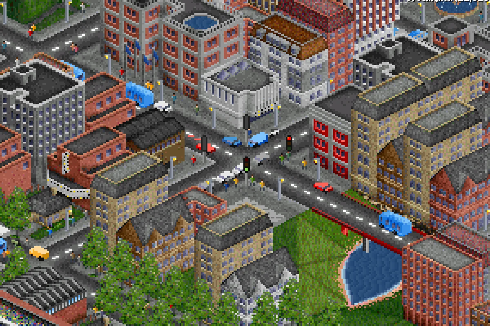 Traffic lights in a town centre, and the town traffic they hold.</td>
  </tr>
  <tr>
    <td width="50%" valign="top">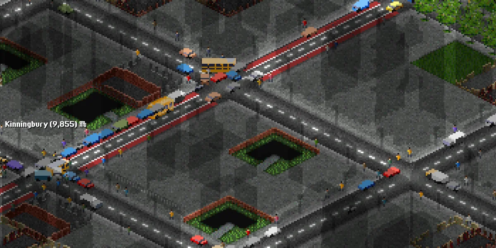 Bus lanes: the buses pass the queue.</td>
    <td width="50%" valign="top">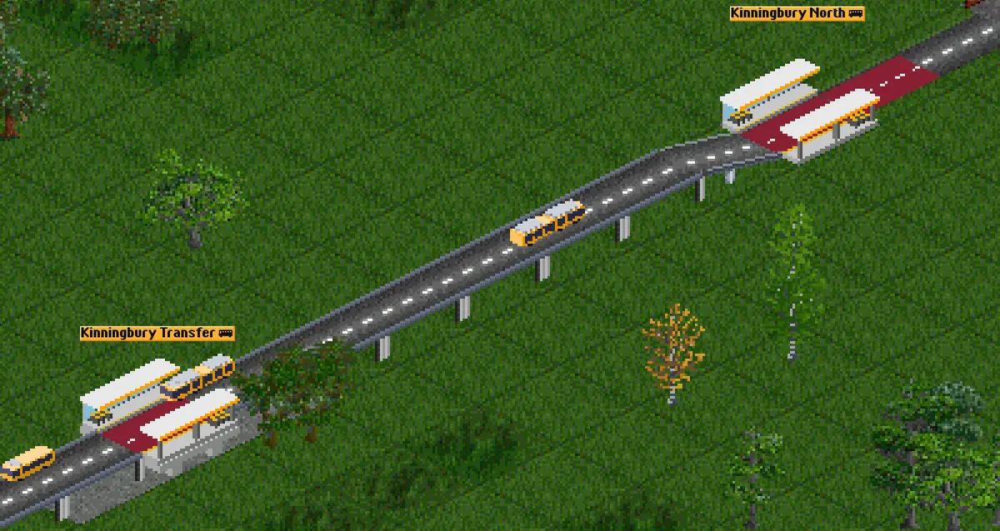 An elevated busway with a station on the viaduct, Sunway style.</td>
  </tr>
  <tr>
    <td width="50%" valign="top">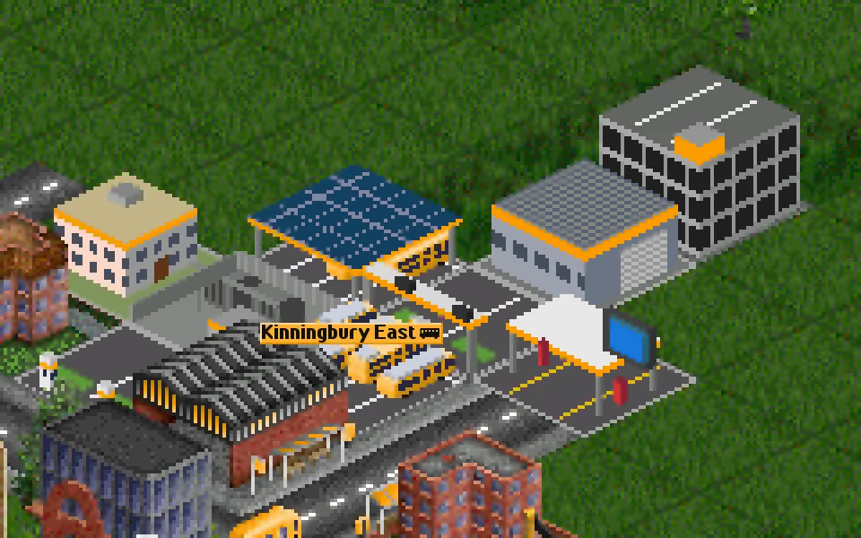 A depot yard with a solar bus park, chargers and a repair bay.</td>
    <td width="50%" valign="top">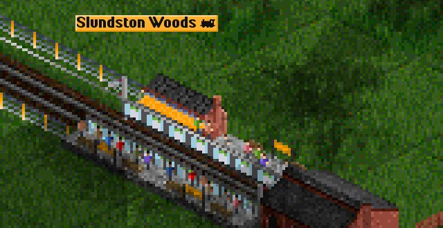 Metro stations with platform screen doors.</td>
  </tr>
  <tr>
    <td width="50%" valign="top">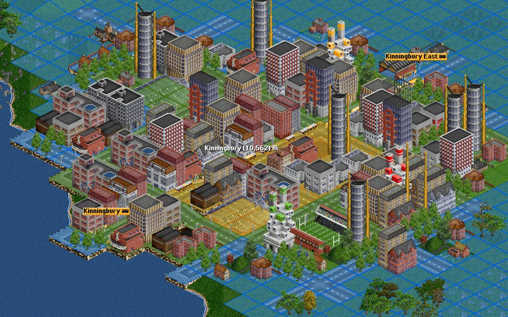 Air pollution, on Malaysia's API and Singapore's PSI.</td>
    <td width="50%" valign="top">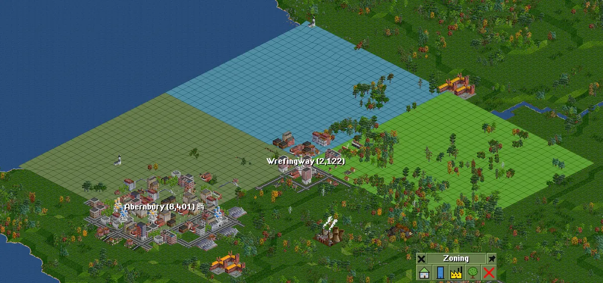 Zoning: where a town builds homes, shops, industry and parks.</td>
  </tr>
  <tr>
    <td width="50%" valign="top">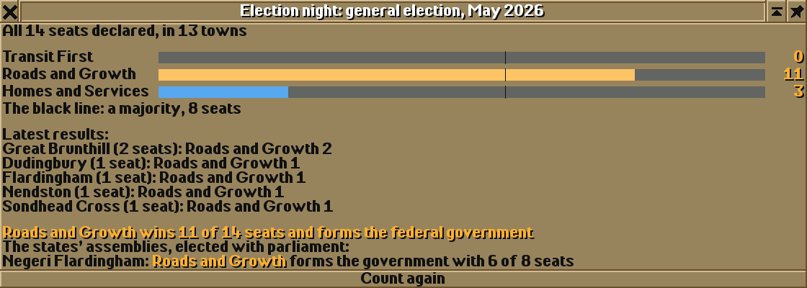 Election night: the count and the result (0.4.0).</td>
    <td width="50%" valign="top">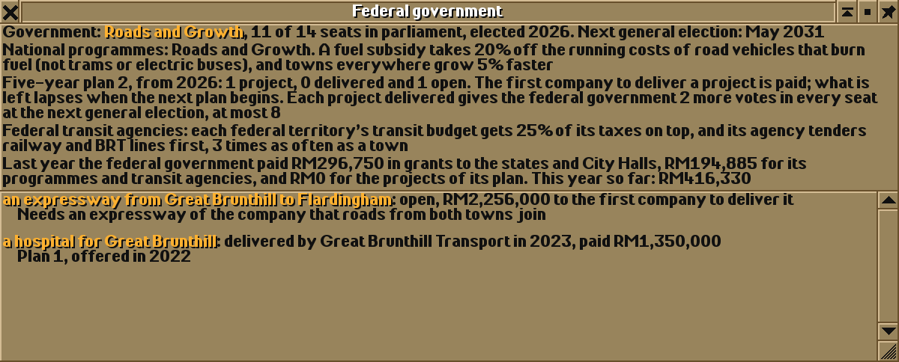 The federal government: programmes, the five-year plan and its projects (0.4.0).</td>
  </tr>
</table>

## Start in five minutes

1. Download `wirabandar-<version>-windows-x64.zip` from the
   [latest release](https://github.com/hithereiamaliff/wirabandar/releases/latest).
2. Unzip it anywhere and run `wirabandar.exe`. The game isn't code-signed, so Windows SmartScreen may ask
   once: click **More info**, then **Run anyway**.
3. The first time it starts, the in-game tutorial offers to show you, step by step, how to start a game and
   build your first bus line, and it makes the button to click flash. It's always under **Tutorial** in the
   main menu.
4. Read on in the [guides](https://wirabandar.techmavie.digital), which explain every feature, with
   tutorials for a first bus network, a council's services, a Transit First state and a BRT corridor.

  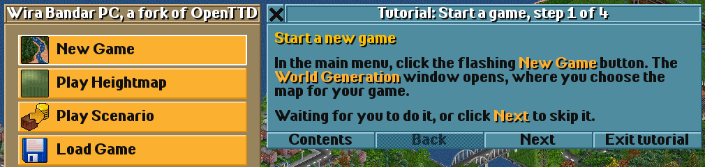

## Questions

**Is it free?** Yes. Like OpenTTD, Wira Bandar PC is free software under the GNU GPL v2, and its source
code is this repository.

**Is it OpenTTD?** It's a fork of OpenTTD: OpenTTD's code with changes, not a game made from scratch.
Everything OpenTTD has is still there, and the city and transit features are added on top. It isn't made or
supported by the OpenTTD team, so please don't report its problems to them.

**Do I need OpenTTD installed?** No. If you have it, Wira Bandar PC uses your OpenTTD settings, saves,
graphics, NewGRFs and AIs, and never changes OpenTTD's folder. If you don't, it downloads the free OpenGFX
graphics the first time.

**Which computers does it run on?** There is a ready-made download for 64-bit Windows. It also builds on
Linux from the source code, as OpenTTD does (see [Compiling OpenTTD](#17-compiling-openttd) below).

## Saves, folders and versions

- It keeps its settings and saves in `Documents\Wira Bandar`. The first time it starts, it copies the
  settings and saves from `Documents\OpenTTD` (copies; nothing there is moved or deleted), and it still
  finds the graphics, NewGRFs and AIs installed for OpenTTD, in `Documents\OpenTTD` and in OpenTTD's own
  folder (`C:\Program Files\OpenTTD`).
- It loads OpenTTD's `.sav` files and saves its own games as `.csav`, which OpenTTD can't open.
- Every version has its own release on the [releases page](https://github.com/hithereiamaliff/wirabandar/releases),
  with its zip named after it (for example `wirabandar-0.4.0-windows-x64.zip`); what changed in each one is in
  [docs/wirabandar-changelog.md](docs/wirabandar-changelog.md). The game shows its version in the window title,
  at the bottom of the main menu and in the About window. The old link
  https://github.com/hithereiamaliff/wirabandar/releases/download/latest/wirabandar-windows-x64.zip
  still gets the newest build.
- What each step of the game added, and how it was tested, is in
  [docs/city-builder-plan.md](docs/city-builder-plan.md).

## Credits and licence

Wira Bandar PC is a fork of OpenTTD and, like OpenTTD, free software under the GNU General Public License
version 2 (see [COPYING.md](./COPYING.md)); its source code is this repository. OpenTTD's authors are
credited in the game's About window and below. Wira Bandar PC is not made or supported by the OpenTTD team:
please don't report its problems to them.

The rest of this file is OpenTTD's own readme.

---

# OpenTTD

## Table of contents

- 1.0) [About](#10-about)
    - 1.1) [Downloading OpenTTD](#11-downloading-openttd)
    - 1.2) [OpenTTD gameplay manual](#12-openttd-gameplay-manual)
    - 1.3) [Supported platforms](#13-supported-platforms)
    - 1.4) [Installing and running OpenTTD](#14-installing-and-running-openttd)
    - 1.5) [Add-on content / mods](#15-add-on-content--mods)
    - 1.6) [OpenTTD directories](#16-openttd-directories)
    - 1.7) [Compiling OpenTTD](#17-compiling-openttd)
- 2.0) [Contact and community](#20-contact-and-community)
    - 2.1) [Multiplayer games](#21-multiplayer-games)
    - 2.2) [Contributing to OpenTTD](#22-contributing-to-openttd)
    - 2.3) [Reporting bugs](#23-reporting-bugs)
    - 2.4) [Translating](#24-translating)
- 3.0) [Licensing](#30-licensing)
- 4.0) [Credits](#40-credits)

## 1.0) About

OpenTTD is a transport simulation game based upon the popular game Transport Tycoon Deluxe, written by Chris Sawyer.
It attempts to mimic the original game as closely as possible while extending it with new features.

OpenTTD is licensed under the GNU General Public License version 2.0, but includes some 3rd party software under different licenses.
See the section ["Licensing"](#30-licensing) below for details.

## 1.1) Downloading OpenTTD

OpenTTD can be downloaded from the [official OpenTTD website](https://www.openttd.org/).

Both 'stable' and 'nightly' versions are available for download:

- most people should choose the 'stable' version, as this has been more extensively tested
- the 'nightly' version includes the latest changes and features, but may sometimes be less reliable

OpenTTD is also available for free on [Steam](https://store.steampowered.com/app/1536610/OpenTTD/), [GOG.com](https://www.gog.com/game/openttd), and the [Microsoft Store](https://www.microsoft.com/p/openttd-official/9ncjg5rvrr1c). On some platforms OpenTTD will be available via your OS package manager or a similar service.

## 1.2) OpenTTD gameplay manual

OpenTTD has a [community-maintained wiki](https://wiki.openttd.org/), including a gameplay manual and tips.

## 1.3) Supported platforms

OpenTTD has been ported to several platforms and operating systems.

The currently supported platforms are:

- Linux (SDL (OpenGL and non-OpenGL))
- macOS (universal) (Cocoa)
- Windows (Win32 GDI / OpenGL)

Other platforms may also work (in particular various BSD systems), but we don't actively test or maintain these.

### 1.3.1) Legacy support

Platforms, languages and compilers change.
We'll keep support going on old platforms as long as someone is interested in supporting them, except where it means the project can't move forward to keep up with language and compiler features.

We guarantee that every revision of OpenTTD will be able to load savegames from every older revision (excepting where the savegame is corrupt).
Please report a bug if you find a save that doesn't load.

## 1.4) Installing and running OpenTTD

OpenTTD is usually straightforward to install, but for more help the wiki [includes an installation guide](https://wiki.openttd.org/en/Manual/Installation).

OpenTTD needs some additional graphics and sound files to run.

For some platforms these will be downloaded during the installation process if required.

For some platforms, you will need to refer to [the installation guide](https://wiki.openttd.org/en/Manual/Installation).

### 1.4.1) Free graphics and sound files

The free data files, split into OpenGFX for graphics, OpenSFX for sounds and
OpenMSX for music can be found at:

- [OpenGFX](https://www.openttd.org/downloads/opengfx-releases/latest)
- [OpenSFX](https://www.openttd.org/downloads/opensfx-releases/latest)
- [OpenMSX](https://www.openttd.org/downloads/openmsx-releases/latest)

Please follow the readme of these packages about the installation procedure.
The Windows installer can optionally download and install these packages.

### 1.4.2) Original Transport Tycoon Deluxe graphics and sound files

If you want to play with the original Transport Tycoon Deluxe data files you have to copy the data files from the CD-ROM into the baseset/ directory.
It does not matter whether you copy them from the DOS or Windows version of Transport Tycoon Deluxe.
The Windows install can optionally copy these files.

You need to copy the following files:
- sample.cat
- trg1r.grf or TRG1.GRF
- trgcr.grf or TRGC.GRF
- trghr.grf or TRGH.GRF
- trgir.grf or TRGI.GRF
- trgtr.grf or TRGT.GRF

### 1.4.3) Original Transport Tycoon Deluxe music

If you want the Transport Tycoon Deluxe music, copy the appropriate files from the original game into the baseset folder.
- TTD for Windows: All files in the gm/ folder (gm_tt00.gm up to gm_tt21.gm)
- TTD for DOS: The GM.CAT file
- Transport Tycoon Original: The GM.CAT file, but rename it to GM-TTO.CAT

## 1.5) Add-on content / mods

OpenTTD features multiple types of add-on content, which modify gameplay in different ways.

Most types of add-on content can be downloaded within OpenTTD via the 'Check Online Content' button in the main menu.

Add-on content can also be installed manually, but that's more complicated; the [OpenTTD wiki](https://wiki.openttd.org/) may offer help with that, or the [OpenTTD directory structure guide](./docs/directory_structure.md).

### 1.5.1) Social Integration

OpenTTD has the ability to load plugins to integrate with Social Platforms like Steam, Discord, etc.

To enable such integration, the plugin for the specific platform has to be downloaded and stored in the `social_integration` folder.

See [OpenTTD's website](https://www.openttd.org), under Downloads, for what plugins are available.

### 1.6) OpenTTD directories

OpenTTD uses its own directory structure to store game data, add-on content etc.

For more information, see the [directory structure guide](./docs/directory_structure.md).

### 1.7) Compiling OpenTTD

If you want to compile OpenTTD from source, instructions can be found in [COMPILING.md](./COMPILING.md).

## 2.0) Contact and Community

'Official' channels

- [OpenTTD website](https://www.openttd.org)
- [OpenTTD official Discord](https://discord.gg/openttd)
- IRC chat using #openttd on irc.oftc.net [more info about our irc channel](https://wiki.openttd.org/en/Development/IRC%20channel)
- [OpenTTD on Github](https://github.com/OpenTTD/) for code repositories and for reporting issues
- [forum.openttd.org](https://forum.openttd.org/) - the primary community forum site for discussing OpenTTD and related games
- [OpenTTD wiki](https://wiki.openttd.org/) community-maintained wiki, including topics like gameplay guide, detailed explanation of some game mechanics, how to use add-on content (mods) and much more

'Unofficial' channels

- the OpenTTD wiki has a [page listing OpenTTD communities](https://wiki.openttd.org/en/Community/Community) including some in languages other than English

### 2.1) Multiplayer games

You can play OpenTTD with others, either cooperatively or competitively.

See the [multiplayer documentation](./docs/multiplayer.md) for more details.

### 2.2) Contributing to OpenTTD

We welcome contributors to OpenTTD.  More information for contributors can be found in [CONTRIBUTING.md](./CONTRIBUTING.md)

### 2.3) Reporting bugs

Good bug reports are very helpful.  We have a [guide to reporting bugs](./CONTRIBUTING.md#bug-reports) to help with this.

Desyncs in multiplayer are complex to debug and report (some software development skils are required).
Instructions can be found in [debugging and reporting desyncs](./docs/debugging_desyncs.md).

### 2.4) Translating

OpenTTD is translated into many languages.  Translations are added and updated via the [online translation tool](https://translator.openttd.org).

## 3.0) Licensing

OpenTTD is licensed under the GNU General Public License version 2.0.
For the complete license text, see the file '[COPYING.md](./COPYING.md)'.
This license applies to all files in this distribution, except as noted below.

The squirrel implementation in `src/3rdparty/squirrel` is licensed under the Zlib license.
See `src/3rdparty/squirrel/COPYRIGHT` for the complete license text.

The md5 implementation in `src/3rdparty/md5` is licensed under the Zlib license.
See the comments in the source files in `src/3rdparty/md5` for the complete license text.

The fmt implementation in `src/3rdparty/fmt` is licensed under the MIT license.
See `src/3rdparty/fmt/LICENSE.rst` for the complete license text.

The nlohmann json implementation in `src/3rdparty/nlohmann` is licensed under the MIT license.
See `src/3rdparty/nlohmann/LICENSE.MIT` for the complete license text.

The OpenGL API in `src/3rdparty/opengl` is licensed under the MIT license.
See `src/3rdparty/opengl/khrplatform.h` for the complete license text.

The catch2 implementation in `src/3rdparty/catch2` is licensed under the Boost Software License, Version 1.0.
See `src/3rdparty/catch2/LICENSE.txt` for the complete license text.

The icu scriptrun implementation in `src/3rdparty/icu` is licensed under the Unicode license.
See `src/3rdparty/icu/LICENSE` for the complete license text.

The monocypher implementation in `src/3rdparty/monocypher` is licensed under the 2-clause BSD and CC-0 license.
See `src/3rdparty/monocypher/LICENSE.md` for the complete license text.

The OpenTTD Social Integration API in `src/3rdparty/openttd_social_integration_api` is licensed under the MIT license.
See `src/3rdparty/openttd_social_integration_api/LICENSE` for the complete license text.

The atomic datatype support detection in `cmake/3rdparty/llvm/CheckAtomic.cmake` is licensed under the Apache 2.0 license.
See `cmake/3rdparty/llvm/LICENSE.txt` for the complete license text.

## 4.0) Credits

See [CREDITS.md](./CREDITS.md)
